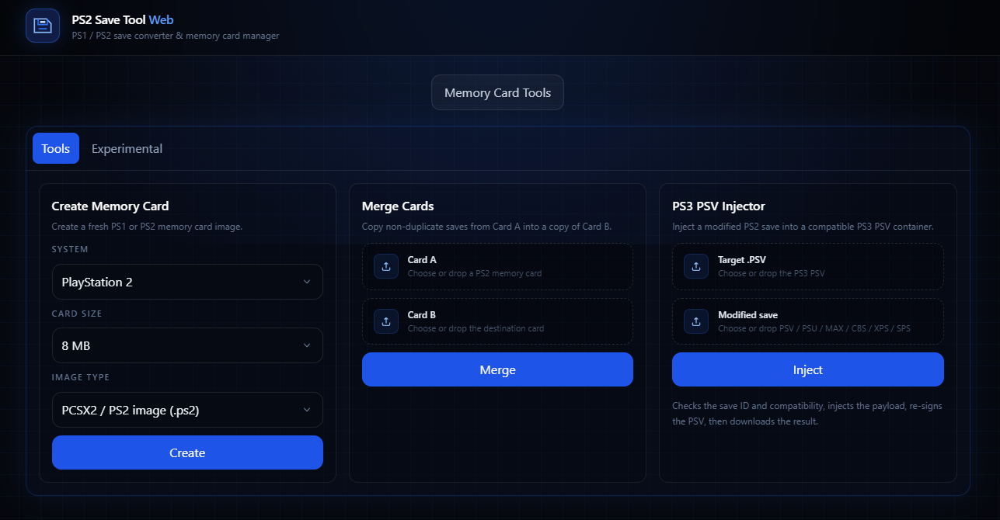
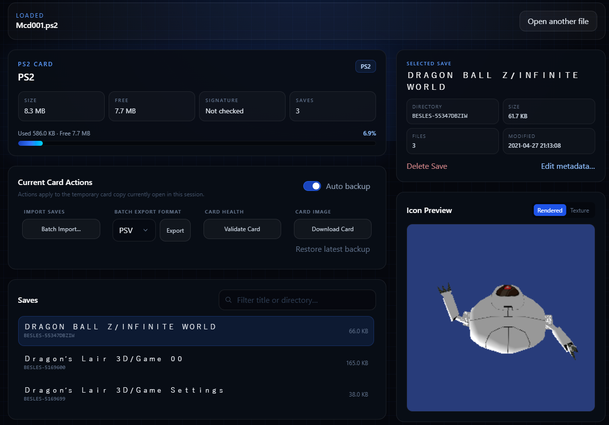
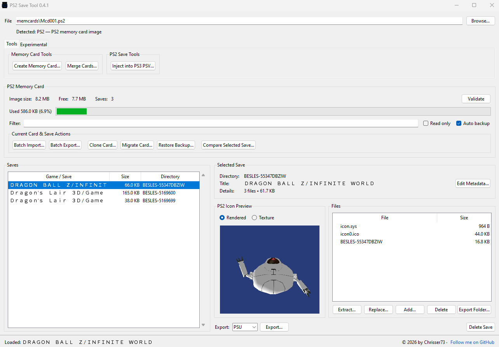

# PlayStation Save & Memory Card Tools

[](https://github.com/Chrisser73/ps2-save-tool/actions/workflows/tests.yml)
[](https://github.com/Chrisser73/ps2-save-tool/pkgs/container/ps2-save-tool-web)
[](https://github.com/Chrisser73/ps2-save-tool/releases)
[](https://github.com/Chrisser73/ps2-save-tool/releases)
[](LICENSE)
[](CHANGELOG.md#desktop-app)
[](CHANGELOG.md#web-app)

**PS2 Save Tool** is the project name, but the toolset goes further: edit and convert PS1/PS2 saves, prepare compatible PS2 saves for PS3 PS2 Classics, and manage PS1/PS2 memory cards. Choose the desktop app for a native interface or the web edition for responsive self-hosting in a browser.

### Web App



### Desktop App


## Choose an edition

| Edition | Best for | How to run |
| --- | --- | --- |
| **Desktop (Python/Tkinter)** | A local Windows application and a self-contained `.exe` build | [Desktop app](#desktop-app-python--tkinter) |
| **Web (Vue + FastAPI)** | Browser access on a desktop, tablet, or mobile device; self-hosting with Docker | [Web app](#web-app-vue--fastapi) |

Both editions work with PS1 and PS2 saves and memory cards. They keep PS1 and PS2 workflows separate and do not perform invalid cross-platform conversions.

## What you can do

| | |
| --- | --- |
| **Convert & edit saves** | Convert PS2 `PSV`, `PSU`, and `MAX` saves; work with PS1 `PSV`, `MCS`, `PSX`, and RAW saves; inspect, edit metadata, and manage the files inside saves. |
| **Prepare PS3 PS2 Classics saves** | Inject a compatible modified PS2 save into a PS3 PS2 Classics `.PSV`. Signature and game/region compatibility checks help prevent invalid conversions. |
| **Manage Memory Cards** | Open PS1 and PS2 card images, browse saves, filter, batch import/export, clone cards, merge cards, migrate PS2 cards, and export save folders. |
| **Preview save icons** | Inspect PS2 3D icons and raw textures, plus PS1 save icons, before moving data around. |
| **Protect your data** | Read-only mode, automatic backups, validation, duplicate comparison, and experimental non-destructive PS2 card rebuilds keep the original intact. |

### Supported workflows at a glance

- **PS1:** inspect and convert individual saves; edit and export compatible virtual memory cards.
- **PS2:** convert saves, edit save metadata and files, and manage `.ps2`, `.mc2`, and compatible card images.
- **PS3:** replace the PS2 payload inside a compatible PS3 PS2 Classics `.PSV` while retaining and verifying its signature.

## Desktop app (Python / Tkinter)

**Current desktop version:** 0.4.1. Python 3.10+ is recommended.

### Windows: run from source

```bat
python -m pip install -r requirements.txt
start.bat
```

Or run `python ps2_save_tool.py` directly.

### Linux, macOS, or WSL: run with Make

Install Python 3.10+ and GNU Make, then run:

```bash
make desktop-setup
make desktop-run
```

The Make targets create an ignored `.venv-unix` automatically. This avoids system-wide `pip` writes and works with Debian/Ubuntu's PEP 668 protection in WSL.

### Run the desktop tests locally

```bat
test.bat
```

On macOS/Linux:

```bash
./test.sh
```

Or, in Linux/macOS/WSL:

```bash
make desktop-test
```

### Build the Windows executable

```bat
python -m pip install -r requirements-build.txt
build.bat
```

The builder checks its prerequisites and tests, then writes one file to `_build/`: `PS2 Save Tool v<version>.exe`.

The packaged `.exe` is intentionally a Windows-only artifact. On Linux, macOS, or WSL, use `make desktop-run` to run the desktop edition from source.

## Web app (Vue / FastAPI)

**Current web version:** 0.2.1. The web edition has a Vue 3 frontend, FastAPI backend, and Nginx production frontend.

### Run locally without Docker

Requirements: Python 3.10+, Node.js 20.19+ (Node 22 LTS recommended), and npm.

From `web/`, use the setup script once, then the start script:

```bat
setup.bat
start-local.bat
```

Open `http://localhost:5173`. The local backend health endpoint is `http://localhost:6361/api/health`.

On Linux/macOS/WSL, the same workflow is available as Make targets from the repository root:

```bash
make web-setup
make web-start
```

This is equivalent to `web/setup.sh` and `web/start-local.sh`; it starts the frontend at `http://localhost:5173` and backend at `http://localhost:6361`.

Windows and Unix-like systems deliberately use separate ignored virtual environments (`backend/.venv` and `backend/.venv-unix`), so the same checkout can be used from PowerShell and WSL without either setup overwriting the other.

### Run web tests locally

After setup, from `web/`:

```bat
test.bat
```

On Linux/macOS:

```bash
./test.sh
```

Or from the repository root:

```bash
make web-test
make test           # desktop and web Python test suites
make preflight      # versions, badges, tests, and production frontend build
```

### Self-host with Docker

The GitHub workflow publishes AMD64 and ARM64 images after every push to `main`:

- `ghcr.io/chrisser73/ps2-save-tool-web:latest` — Nginx frontend
- `ghcr.io/chrisser73/ps2-save-tool-api:latest` — FastAPI backend

Pushing a `web-vX.Y.Z` release tag also publishes matching immutable `X.Y.Z` image tags for both images.

From `web/` on the server:

```bash
cp .env.example .env
docker compose pull
docker compose up -d
```

Open `http://YOUR-SERVER-IP:9496`. Change `WEB_PORT` in `.env` if necessary.

`compose.yaml` intentionally uses the published GHCR images, which is the right default for a deployment. To build the checked-out source instead, use the local override:

```bash
docker compose -f compose.yaml -f compose.dev.yaml up -d --build
```

From Linux/macOS/WSL, the same Docker flows are also available from the repository root:

```bash
make docker-up      # pull and run the published GHCR images
make docker-dev     # build and run this checkout
make docker-logs    # follow logs
make docker-down    # stop the stack
```

The backend remains internal to the Compose network; Nginx forwards `/api/` requests to it. The committed `web/frontend/nginx.conf` is the production configuration used by the image, not an example file: it has no machine-specific values or secrets and belongs under version control.

Run `make help` for the complete list of Make targets.

## Testing and publishing

The **Tests** GitHub Actions workflow runs desktop Python tests, web-backend Python tests, and a production frontend build on pushes and pull requests. Its status powers the badge at the top of this README.

The **Publish web images** workflow runs on pushes to `main` and pushes the two Docker images for `linux/amd64` and `linux/arm64`; a `web-vX.Y.Z` tag additionally receives immutable `X.Y.Z` image tags. GitHub Packages must be made public once in the repository/package settings if anonymous image pulls are desired.

## Versions and releases

Desktop and web releases are independent: the current versions are **desktop 0.4.1** and **web 0.2.1**. A desktop-only Windows fix can therefore be released as `desktop-v0.4.2` without changing the web edition; a web-only feature can become `web-v0.2.2` without rebuilding the Windows executable.

Use `make preflight` before releasing. It installs missing local test/build dependencies, verifies semantic versions and README badge sources, runs both Python test suites, and creates the production frontend build. Each run writes a timestamped log under `logs/`; the directory is deliberately ignored by Git. Then follow the component-specific steps in [RELEASING.md](RELEASING.md). The [CHANGELOG.md](CHANGELOG.md) has separate Desktop and Web sections linked to their corresponding GitHub releases; pushing a matching `desktop-vX.Y.Z` or `web-vX.Y.Z` tag validates the component and automatically creates that GitHub Release.

## Safety

Memory-card images and saves can contain important progress. Keep original copies. Auto Backup is enabled by default for destructive card operations, and the repair workflow always creates a new card rather than modifying the source in place.

## License and third-party software

See [LICENSE](LICENSE) and [THIRD_PARTY.md](THIRD_PARTY.md). The web edition's notices are in [web/THIRD_PARTY.md](web/THIRD_PARTY.md).
